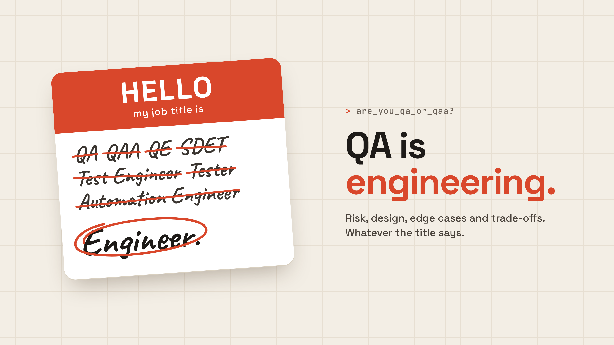

+++
date = '2026-11-02T22:49:40+01:00'
draft = true
title = 'Why I Started This Blog'
+++
On my first days at a new job, a colleague asked me: “Are you QA or QAA?”

(If you work in testing, you know the struggle: QA, QAA, QE, SDET, Test Engineer, Automation Engineer… we have more job titles than most teams have test environments.)

I answered quickly: “QA.” He just shook his head and said, “Super.” The ironic kind of super.

Only later did I realize what he meant. He assumed I was “just” a manual tester. In that moment I didn’t even understand the question, and I didn’t correct him. Was it nerves? Was it the quiet weight of stereotypes about women in IT? Why did I lose my confidence right when I needed it?

That wasn’t the first time. Looking back on my career, there were many moments when I should have spoken up, dug deeper, and made my case. This blog is me doing that now.

QA is engineering. In the AI era, when anyone can generate code, what separates engineers isn’t whether they can write it. It’s whether they approach problems like engineers: thinking about risk, design, edge cases and trade-offs. That’s the core of good quality work.

In fact, I think QA has an advantage right now. We know the product end to end. We read developers’ code to understand what changed and what might break. We analyze, we monitor the app’s health, we know where it’s fragile. That’s exactly the context AI needs to automate processes well, and QA already holds it.

I also want to challenge another stereotype: that women choose QA because it’s the “easier” or more convenient way into tech. I didn’t, and neither did many of the women I know.

So here I’ll write about test automation, what it really takes to be an SDET, mentoring, and being a woman in this field, including the things I wish someone had told me earlier.

